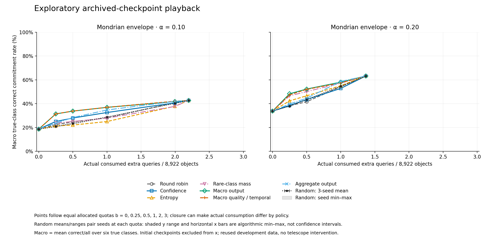

# Completed exploratory research: rare-class decisions and checkpoint budgets

The working deliverable adds class-sensitive lifetime candidate sets, fixed-deadline controls, a causal budget allocator, learned continuation ranking, per-class/emitted-label diagnostics, and reproducible playback commands. Both planned studies finished: **480 fixed-deadline cells and 1,320 allocation cells**, using the same 8,922 development objects and twenty existing classifier fits. No production default changed.

The evidence is mixed. A small output-only continuation learner improves correct-decision yield at several fixed query budgets. Class-balanced learning changes which classes receive useful decisions. The quality/temporal feature additions do not show a consistent benefit. Most importantly, true-class lifetime protection does not make emitted rare labels precise: some protected singleton policies predominantly produce false TDE or SLSN claims. This framework exposes those failures; it has not solved reliable automatic rare-transient classification.

## Scope and inferential meaning

The five outer object folds, proper-training/calibration/evaluation roles and four horizons (5/10/20/100 days) are inherited unchanged. Evaluation truth comes from dataset labels, not predictions. Old test objects and historical anomalies were excluded. All these development outcomes were available to earlier research and are now adaptively reused; this is not fresh confirmatory validation.

Class-Mondrian trajectory calibration controls the probability of ever excluding the true class under exchangeability of whole trajectories within each class and a fixed schedule/scorer. A wrong singleton implies true-class exclusion. Thus the theoretical target is wrong commitments divided by ALL members of a true class. It is neither error conditional on selection nor precision among predictions of a rare label. Finite observed rates may fluctuate around nominal coverage; no new high-confidence empirical certificate is asserted here.

The mathematical ingredients already appear in [Selection-Safe Conformal Early Exit](https://arxiv.org/abs/2610.20773), including its Mondrian extension, and [COINS](https://arxiv.org/abs/2609.07112). The [literature audit](literature_novelty.md) and [independent novelty decision](review-stage/NOVELTY_DECISION.md) explicitly reject generic new-framework positioning.

## The protection cliff and misleading rare singleton labels

There are only 13,14,11,9,11 calibration TDEs across the folds. Deterministic class exclusion needs at least ceil(1/alpha)-1 examples. At alpha=.05, all TDE thresholds are infinite: TDE remains in every object's candidate set. Consequently every singleton, if any, must be TDE. At alpha=.01, multiple classes are unexcludable and no singleton is possible.

The realized alpha=.05 Mondrian envelope emits 67 TDE labels, of which **five are correct and 62 are wrong** (7.46% precision). Its protection of true TDEs is compatible with this failure. Bonferroni-Mondrian at lifetime alpha=.20 spends .05 per look and similarly emits 411 TDE labels with only 27 correct. Emitted-label precision/confusion was added as a post-pilot diagnostic computed from the saved decisions, without another model run; it is descriptive. These are finite-resolution/decision-definition failures, not evidence that the implementation violated its coverage construction.

At alpha=.10 and a day100 deadline:

| Set policy | Correct commitments | Wrong commitments | Mean day consumed, all objects |
|---|---:|---:|---:|
| Pooled lifetime envelope | 7,548 | 820 | 25.68 |
| Class-Mondrian lifetime envelope | 4,721 | 382 | 63.56 |
| Class-Mondrian fixed day100 | 7,120 | 542 | 100.00 |

These operating points have different protection/timing properties; the table does not establish dominance. Separate fixed-look Mondrian controls at days5/10/20/100 use full alpha at that prespecified deadline and are stronger than trivial early abstention by a terminal-only rule. They do not permit adaptive choice among deadlines at full alpha.

The rare-class tradeoff is explicit:

| True class | Objects | Pooled correct / wrong | Lifetime Mondrian correct / wrong | Fixed day100 Mondrian correct / wrong |
|---|---:|---:|---:|---:|
| SLSN | 132 | 23 / 96 | 13 / 7 | 23 / 13 |
| TDE | 58 | 30 / 22 | 15 / 1 | 33 / 3 |

Lifetime Mondrian leaves 112 true SLSN and 39 true TDE unresolved while retaining their true class. Among its emitted labels at alpha=.10, SLSN precision is 13/90=14.44%, and TDE precision is 15/82=18.29%. Calling these outputs automatically publishable classifications would be unsupported.

## Budgeted continuation: useful scheduling, incomplete rare-class solution

Every object initially exposes day5. A token reveals one object's next checkpoint, not one photometric observation or a telescope intervention. Each fold runs a separate queue with floor(b*N_fold) extra tokens for b=0,.25,.5,1,2,3. All policies close singleton, empty, and final-look objects identically; no policy reads future probabilities, candidate sets, labels or nobs to choose an action. Realized photometric counts are measured after revelation. Fixed-deadline diagnostic abstainers pay their full deadline; operational allocation instead closes empty sets immediately, so those cost conventions are distinguished.

The rankers use only proper-training early-stop feature/reward rows. Those objects influenced classifier early stopping, so they are not wholly untouched out-of-fold scores. The training closure targets also use thresholds estimated from separate calibration labels. All rankers receive the same known time basis; quality/temporal adds only current nobs, previous probability change and previous label switch. Regression outputs are utility rankings, not calibrated probabilities.

The following cell belongs to the prespecified exploratory grid and was **chosen for presentation after seeing results**: Mondrian alpha=.10, one extra token per evaluation object (8,922 extra tokens total). There was no single primary confirmatory comparison, and this display does not select a policy for deployment. Every grid cell remains available. Macro correct rate averages correct/all over all six true classes; it is not a rare-only measure.

| Allocation policy | Correct | Wrong | Six-class macro correct rate | Mean photometric observations consumed | Mean day consumed |
|---|---:|---:|---:|---:|---:|
| Round robin | 2,256 | 135 | 28.12% | 7.48 | 10.68 |
| High entropy | 1,841 | 189 | 24.99% | 10.68 | 24.02 |
| Rare probability mass | 1,927 | 182 | 27.85% | 12.24 | 27.63 |
| High confidence | 3,377 | 162 | 32.56% | 11.09 | 25.01 |
| Learned aggregate reward, outputs | 3,821 | 155 | 34.69% | 10.38 | 24.14 |
| Learned macro reward, outputs | 3,424 | 170 | 36.88% | 10.01 | 21.21 |
| Learned macro reward, quality/temporal | 3,385 | 179 | 36.94% | 9.84 | 21.05 |

The aggregate output-only learner produces 444 more correct decisions than confidence priority at this cell, with seven fewer wrong decisions and lower observed photometry/time consumption. Correct counts improve in each of the five folds; errors do not improve in every fold. Fold differences are descriptive, since training sets overlap and the dataset has been repeatedly inspected. This is an exploratory scheduling signal, not independent confirmation or a general superiority claim.

Both macro learners exceed the per-cell best heuristic/random control in all seven nonsaturated Mondrian grid cells; this is a descriptive comparison envelope, not selection of a deployable control or seven independent trials. Class-balanced reward does not dominate all scientific objectives or protection regimes. Under **pooled** calibration at alpha=.10 and b=1, rare-mass priority reaches 64.87% macro correct rate, exceeding macro output-only (63.73%) and macro quality/temporal (63.73%). At pooled alpha=.10, b=.5, entropy also exceeds both macro learners; pooled alpha=.20, b=.25 is another counterexample. Thus the learned scheduling benefit is not uniform across the frozen grid.

Even within the displayed Mondrian cell, the simple rare-mass policy recovers 11 SLSN and 15 TDE correctly (26 total), while macro quality/temporal recovers 10 and 12 (22 total). The quality extension adds only 0.061 percentage points of macro correct rate versus the output-only macro learner, with 39 fewer total correct decisions and nine more wrong decisions. At alpha=.20 it often loses macro utility as well. The full grid therefore does not support a consistent quality-feature improvement or a solved rare-class problem.

At zero extra budget all schedulers have identical initial decisions. At sufficiently large budgets they reach the same first-closure outcomes. Random seed ranges describe algorithmic variability only. The figure plots actual consumed extra queries; equal allocated quotas may consume different amounts when queues exhaust.

## Reproduction, review and decision

Commands and interfaces are documented in [scripts/uq_anytime/README.md](../../../scripts/uq_anytime/README.md). The [frozen experiment plan](refine-logs/EXPERIMENT_PLAN.md) contains all baselines, pre-run review amendments and metrics. Full raw artifacts remain at `/workspace/.research/flare-uq/rare-budget-v1` and `/workspace/.research/flare-uq/allocation-v1`; portable summaries, complete compressed result records and source hashes are in [results/](results/portable_manifest.json).

The code supplies finite-rank calibration and nested-set operations, first-singleton/fixed-deadline decisions, a generic causal allocation API, CLI replay, saved continuation models and action ledgers. It preserves empty-set referral and explicit budget exhaustion. Tests cover future perturbations, role/truth separation, actual resource accounting, equal policy endpoints and feature parity. The repository-wide check currently reports 229 passed and one pre-existing optional skip; see [integration checks](review-stage/INTEGRATION_CHECKS.md).

Independent Astra reviewers checked scientific design and then reconstructed raw experimental outcomes in a fresh audit. Semantic reviews remain same-family/provisional, with requested model routing distinguished from unavailable exact backend telemetry. The ARIS discovery evidence gate checks that artifacts and positive proceed-pilot receipts exist; its PASS is not a scientific or publication-quality acceptance. The [final integrity audit](review-stage/EXPERIMENT_AUDIT.md) and [claim assessment](review-stage/CLAIMS_FROM_RESULTS.md) give the final scoped verdicts.

Retain this as a tested research framework and a documented utility/protection tradeoff. Do not promote a policy to production, claim a new conformal method, or treat class coverage as trustworthy rare-label publication. Further efficacy claims need genuinely new objects and an explicit scientific loss/review objective.

The [frozen public-data probe](external_feasibility_results.md) inspected 278 deterministic, class-stratified BTS IDs outside the 10,550-object benchmark, including all 12 available SLSN and 10 TDE candidates. None passed the unchanged original first100-day photometry requirements. All selected IDs were already in the original fetch manifest as quality failures; refreshing public ALeRCE photometry did not make this remainder usable. A separate known-quality control reproduced 14 observations (7g/7r) and passed, providing no evidence of an adapter defect in that check. No model predictions were made. This is a concrete failure of this candidate frame, not a claim that all future public data are unavailable, and work did not wait for advisor data.

The execution stop criterion is now met: all frozen experimental cells completed, reusable code and portable evidence are present, review corrections were implemented, and the final audit/claim judgment is recorded. The empirical hypotheses retain their mixed/partial verdicts; stopping does not convert them into success. No paper-writing stage is run.
